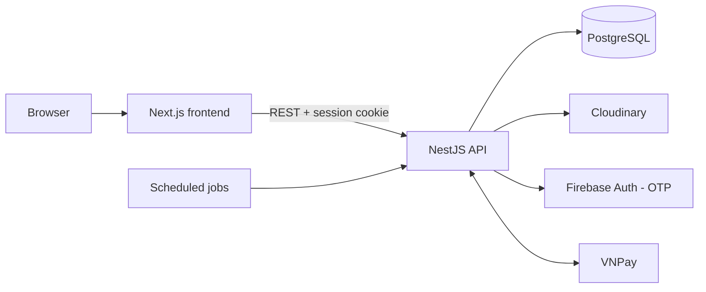

# Healthy Food Marketplace

A multi-vendor marketplace for healthy food. Buyers shop from many independent stores, sellers run their own shops, and admins moderate the platform. A built-in meal planner helps buyers track what they eat.

Built solo as a full-stack project, with a strong focus on backend design.

> **Status:** core flows are implemented; deployment is a work in progress. See [Project status](#project-status).

<!-- Add 2–4 screenshots here, e.g.:


-->

---

## Features

### Buyers
- Sign up and log in with **phone OTP** (Firebase), password reset, and multi-device session management
- Browse products by category, brand, diet tag and allergen; product search
- Product details with variants, nutrition facts and ingredients
- Cart grouped by shop, checkout with saved addresses (Vietnam province / district / ward data)
- **Wallet top-up via VNPay**; order payments are held in **escrow** until the order is completed
- Order tracking, cancellation, and reviews with images
- **Meal planner**: health profile, daily meal and exercise logs, reusable food presets

### Sellers
- Shop registration with document verification
- Product management with variants, images, units and nutrition data
- Order processing, review replies, and a shop wallet
- Apply for **Verified / Official** shop badges

### Admins
- User management, suspension, and **role- and permission-based access control**
- Shop registrations, document review and badge applications
- Catalog management: categories, brands, units, diet tags, allergens
- Order oversight, escrow and wallet monitoring, system configuration

### Background jobs
- Cancel orders whose payment times out
- Auto-complete delivered orders and release escrow
- Reconcile VNPay top-ups
- Re-check and expire shop badges

---

## Tech stack

| Layer | Technology |
| --- | --- |
| Backend | NestJS 11, TypeScript, TypeORM |
| Database | PostgreSQL (`pg_trgm`, `pgcrypto`) |
| Frontend | Next.js 16 (App Router), React 19, Tailwind CSS, SWR |
| Auth | Session cookies (httpOnly), Firebase phone OTP, bcrypt |
| Payments | VNPay |
| Media | Cloudinary |
| API docs | Swagger (OpenAPI) |
| Deployment | Docker (multi-stage build), Procfile |

---

## Architecture



The backend is split into **16 domain modules**:

`auth` · `authorization` · `session` · `verification` · `user` · `buyer` · `shop` · `product` · `cart` · `order` · `payment` · `review` · `penalty` · `location` · `meal-plan` · `system-config`

Design choices:
- **Layered architecture with the repository pattern.** Each module talks to interfaces, and the TypeORM implementations live in `src/database`. Business logic does not depend on the ORM.
- **Typed error handling** with [`neverthrow`](https://github.com/supermacro/neverthrow). Services return `Result` values instead of throwing, and each module maps its own errors to HTTP responses.
- **Unit of work** for operations that touch several tables, such as order creation, payments and shop registration.
- **Database-first schema.** Tables are defined in versioned SQL scripts, and TypeORM `synchronize` is off.

Design documents (in Vietnamese) with PlantUML diagrams are in [`docs/`](docs):

| Folder | Contents |
| --- | --- |
| `02-kien-truc-tong-quan` | System architecture |
| `03-phan-tich-chuc-nang` | Use-case diagram |
| `04-thiet-ke-csdl` | ERDs: core, orders & payments, badges |
| `05-thiet-ke-hoat-dong` | Payment, order cancellation, badge and cron-job flows |
| `06-kien-truc-phan-mem` | Layered architecture, repository pattern |

---

## Project structure

```
.
├── backend/            NestJS API
│   └── src/
│       ├── modules/    16 domain modules
│       ├── database/   TypeORM config and repository implementations
│       ├── common/     configs, decorators, exception filters, pipes
│       └── shared/     errors, logging, image processing, unit of work
├── frontend/           Next.js app (buyer, seller and admin UIs)
├── DB configs/         SQL schema scripts and seed data
└── docs/               Design documents and diagrams
```

---

## Getting started

### Prerequisites
- Node.js 22+
- PostgreSQL 15+
- Accounts for Cloudinary, Firebase (phone auth) and the VNPay sandbox

### 1. Database
Create a database, then run the scripts in `DB configs/` in order:

1. `00_initialization.sql`
2. The scripts in each schema folder, from `01_User Schema` to `15_Meal_Plan Schema`
3. Seed data: `____SEED____.sql`, then `seed_food_presets.sql` and, optionally, `seed_fake_data.sql`

### 2. Backend
```bash
cd backend
cp .env.example .env    # fill in DB, Cloudinary, Firebase and VNPay values
npm install
npm run start:dev
```
Set `PORT=3001` in `.env` so the API does not clash with the frontend.
Swagger UI is then available at `http://localhost:3001/api/docs` (disabled in production).

### 3. Frontend
```bash
cd frontend
cp .env.example .env.local    # NEXT_PUBLIC_API_URL=http://localhost:3001
npm install
npm run dev
```
Open `http://localhost:3000`.

### Docker (backend)
```bash
cd backend
docker build -t healthy-market-api .
docker run --env-file .env -p 3001:3001 healthy-market-api
```

---

## Project status

| Area | Status |
| --- | --- |
| Auth, sessions, RBAC | Done |
| Catalog, cart, checkout | Done |
| Wallet, VNPay top-up, escrow | Done |
| Seller and admin dashboards | Done |
| Meal planner | Done |
| Production deployment | In progress |
| Automated tests | Planned |

---

## Author

**Lê Xuân Dũng** — Backend-focused web developer
[GitHub](https://github.com/Dxung) · dung.lx183505@gmail.com
